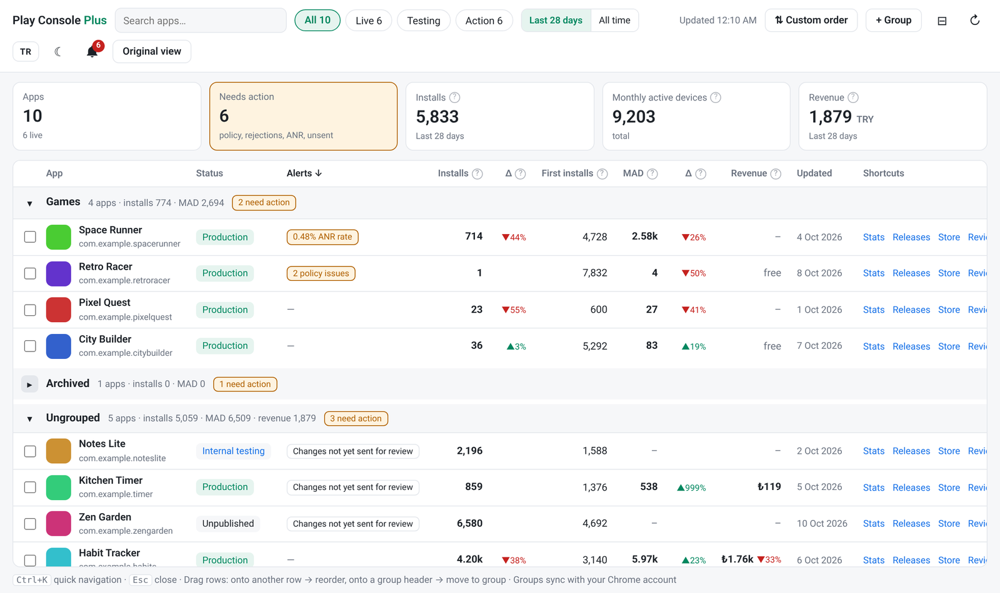
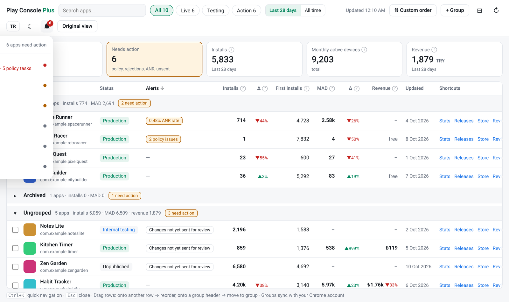
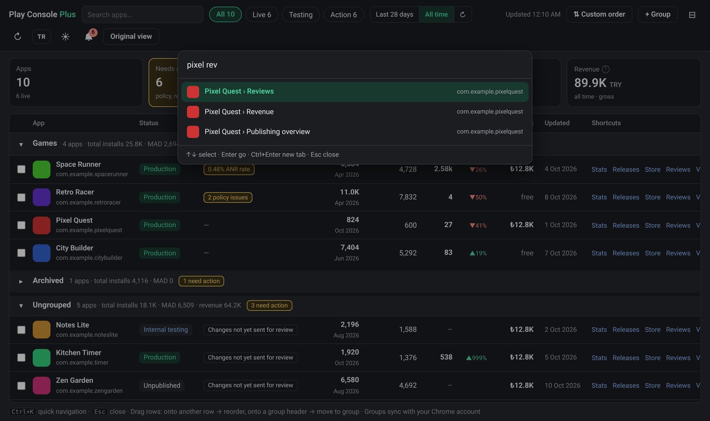
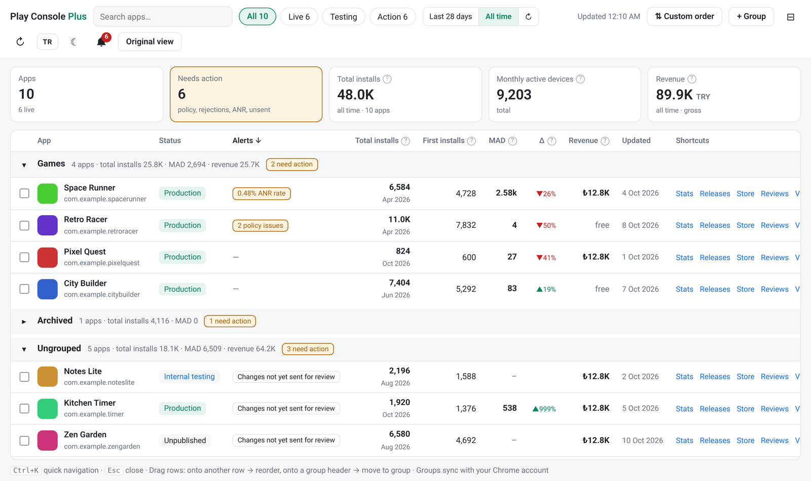

# Play Console Plus

A Chrome extension that gives the **Google Play Console** home page a compact, faster dashboard: all your apps in one sortable table, grouped the way you want, with the alerts that need action, all-time installs and revenue, and keyboard-driven navigation.

> 🇹🇷 Türkçe açıklama aşağıda: [Türkçe](#türkçe)



## Why

The Play Console home page shows each app as a large card, ten per page, with only the last 28 days of data. If you publish many apps, finding the one that needs attention, comparing apps, or just jumping to an app's reviews takes far too many clicks. Play Console Plus puts everything on one screen.

## Features

- **Compact table of every app.** Name, status, alerts, installs, first installs, monthly active devices (MAD), revenue, change vs. the previous period, last update and one-click shortcuts (Stats, Releases, Store listing, Reviews, Vitals, Policy). All pages of the native list are loaded automatically.
- **Sort and filter.** Click any column to sort. Filter by *All / Live / Testing / Needs action* or search by name or package.
- **Groups.** Create groups such as *Games* or *Archived*, then drag apps onto a group header or select them and move them in bulk. Collapse and expand groups, reorder or rename them. Each group header shows its own totals.
- **Custom order.** Drag a row onto another row to put your apps in your own order.
- **Last 28 days or all time.** Switch the whole view between the last 28 days and all time. In all-time mode you get total installs, first installs and lifetime revenue for every app.
- **Notifications.** A bell icon collects everything that needs action — apps removed by Google, rejected changes, policy issues, high ANR rate, changes not yet sent for review — ordered by severity, each linking to the right page.
- **Fetch data on demand.** If Play Console didn't return data for an app, select it and press **Fetch data**. Rows fetched by hand are marked with a stripe pattern and a time badge.
- **Quick navigation.** Press **⌘K** (Mac) or **Ctrl+K** (Windows/Linux) on any Play Console page and type, e.g. `pixel reviews`, to jump to any section of any app. Ctrl/⌘+Enter opens it in a new tab.
- **Dark theme** for the extension view and the whole Play Console.
- **English and Turkish.** Switch with the EN/TR button. The first language follows your browser.
- **Original view any time.** The *Original view* button (or Esc) hides the extension. The *Plus view* button brings it back. Your choice is remembered.
- **Explanations on hover.** Every metric has a `?` tooltip explaining what it means.

| Notifications | Quick navigation (dark theme) |
|---|---|
|  |  |



## Installation

The extension is not on the Chrome Web Store yet, so install it from source. It takes about a minute.

1. **Download the code.** Click the green **Code** button on this page and choose **Download ZIP**, then unzip it. Or clone it:
   ```bash
   git clone https://github.com/yuxel/google-play-console-plus-chrome-extension.git
   ```
2. Open **`chrome://extensions`** in Chrome.
3. Turn on **Developer mode** (top-right switch).
4. Click **Load unpacked** and select the folder that contains `manifest.json`.
5. Open (or reload) [Google Play Console](https://play.google.com/console). The Plus view opens on the home page.

It also works in other Chromium browsers (Edge, Brave, Arc, Opera) the same way: open their extensions page, enable developer mode and load the folder.

### Updating

Download the new version, replace the folder, then press the **↻ reload** icon on the extension's card in `chrome://extensions` and reload Play Console. Your groups and settings are kept.

## Usage

| Action | How |
|---|---|
| Open / close the Plus view | **Plus view** button (bottom-right) / **Original view** button or **Esc** |
| Quick navigation | **⌘K** / **Ctrl+K**, type, **Enter** |
| Sort | Click a column header (click again to reverse) |
| Create a group | **+ Group**. Selected apps are moved into it |
| Move apps to a group | Drag a row onto a group header, or select rows and use the bar at the bottom |
| Reorder apps | Drag a row onto another row. **⇅ Custom order** returns to your order after sorting |
| Collapse a group | Click its name or the ▸ arrow. ⊟ collapses or expands all groups |
| Switch period | **Last 28 days / All time** |
| Re-fetch missing data | Select the apps, then **Fetch data** in the bottom bar |
| Dark theme / language | ☾ and **EN/TR** buttons |

## Where the numbers come from

Everything is read from Play Console pages you can already see, inside your own browser:

| Column | Source |
|---|---|
| Installs, MAD, revenue (28 days), status, alerts | The Play Console home page |
| First installs (28 days) | The app's **Statistics** page: *Device acquisition → New devices*, daily, last 28 days |
| Total installs and first installs (all time) | The app's **Statistics** page: *Device acquisition → All devices / New devices*, monthly, summed from 2017 |
| Revenue (all time) | The app's **Financial reports → Revenue** page, *Lifetime* column (gross) |

Play Console no longer has a separate "installs" metric. It calls installs **device acquisitions**, which include reinstalls. **First installs** are installs on devices that never had the app before. That is the closest metric to unique installs.

To verify a number, open the app's Statistics page with the same metric and date range and add up the rows of the *Data table* at the bottom.

**Known limitation:** for some apps Play Console only provides acquisition data from a certain month onwards. The extension shows that month under the total, and earlier installs are not included.

The statistics and revenue pages are loaded in a hidden frame, two apps at a time, and the results are cached for 12 hours.

## Privacy

- The extension only runs on `https://play.google.com/console/*`.
- The only permission it asks for is `storage`.
- No data is sent anywhere. There are no servers, analytics or tracking.
- App data and settings (theme, language, view) are cached in your browser's local extension storage. Your groups and custom order are stored in Chrome's extension sync storage, so they follow your Chrome profile when Chrome sync is on.
- It never changes anything in your Play Console account. It only reads pages.

## Limitations

- The extension reads the Play Console web pages directly, because there is no public API for this data. If Google changes the Play Console layout, parts of the extension may stop working until they are updated.
- Loading all-time data for many apps takes a while the first time, about 5–10 seconds per app.
- Tested with the Play Console interface in English. Some parts (alert detection, the revenue page, paging in the statistics table) look for English or Turkish labels, so other interface languages may only partly work.

## Project structure

```
manifest.json   Chrome extension manifest (Manifest V3)
content.js      All logic and UI (runs on Play Console pages, UI in a shadow DOM)
icon*.png       Extension icons
docs/           Screenshots for this README (demo data)
```

There is no build step. Edit `content.js` and reload the extension.

## Contributing

Issues and pull requests are welcome, especially fixes when Play Console changes its layout. Please describe which page and language you were using.

## Disclaimer

This is an independent project. It is not affiliated with, endorsed by or sponsored by Google. Google Play and Google Play Console are trademarks of Google LLC.

---

## Türkçe

**Play Console Plus**, Google Play Console ana sayfasını derli toplu bir panele çeviren bir Chrome eklentisi. Tüm uygulamaların sıralanabilir tek bir tabloda duruyor. Onları istediğin gibi gruplayabiliyorsun. Aksiyon gereken uyarılar, tüm zamanlar yükleme ve gelir rakamları ve klavyeyle hızlı gezinme de var.

### Özellikler

- **Tek tabloda tüm uygulamalar.** Durum, uyarılar, yükleme, ilk yükleme, aylık aktif cihaz (MAD), gelir, değişim yüzdeleri ve tek tıkla İstatistik, Sürüm, Mağaza, Yorum, Vitals ve Politika kısayolları.
- **Sıralama, filtre ve arama.**
- **Gruplar.** "Oyunlar" ya da "Arşivlenenler" gibi gruplar oluşturabilir, uygulamaları sürükleyip bırakabilir veya toplu taşıyabilirsin. Gruplar daraltılıp açılabiliyor.
- **Özel sıra.** Satırları sürükleyerek kendi sıranı belirleyebilirsin.
- **Son 28 gün / Tüm zamanlar.** Tüm zamanlar modunda toplam yükleme, ilk yükleme ve tüm zamanlar geliri gösteriliyor.
- **Bildirimler.** 🔔 simgesinde Google'ın kaldırdığı uygulamalar, reddedilen değişiklikler, politika sorunları, ANR ve gönderilmemiş değişiklikler toplanıyor.
- **Veriyi elle çekme.** Verisi gelmeyen uygulamaları seçip **Verisini çek**'e basabilirsin. Elle çekilen satırlar çizgili arka plan ve saat etiketiyle işaretleniyor.
- **Hızlı gezinme.** Mac'te **⌘K**, Windows'ta **Ctrl+K** ile her uygulamanın her bölümüne yazarak gidebilirsin.
- **Karanlık tema**, **Türkçe / İngilizce** arayüz ve istediğin an **Orijinal görünüm**e dönüş.

### Kurulum

1. Bu sayfadaki yeşil **Code** düğmesinden **Download ZIP** ile indir ve zip'i aç. Ya da `git clone` ile klonla.
2. Chrome'da **`chrome://extensions`** sayfasını aç.
3. Sağ üstten **Geliştirici modu**nu aç.
4. **Paketlenmemiş öğe yükle**ye tıkla ve `manifest.json` dosyasının bulunduğu klasörü seç.
5. [Google Play Console](https://play.google.com/console) sayfasını aç ya da yenile.

**Güncellemek için:** Yeni sürümü indir, klasörü değiştir, `chrome://extensions` sayfasında eklentinin ↻ düğmesine bas. Grupların ve ayarların korunur.

### Gizlilik

Eklenti sadece Play Console sayfalarında çalışıyor ve hiçbir yere veri göndermiyor. Sunucusu, analitiği ya da takibi yok. Play Console hesabında hiçbir şeyi değiştirmiyor, sadece sayfaları okuyor. Veriler tarayıcının eklenti deposunda tutuluyor.

### Rakamlar nereden geliyor

Rakamlar Play Console'un kendi sayfalarından, senin tarayıcında okunuyor:

- **Ana sayfa:** 28 günlük yükleme, aylık aktif cihaz ve gelir.
- **İstatistikler sayfası:** ilk yükleme ve tüm zamanlar yükleme sayıları.
- **Finansal raporlar → Gelir sayfası:** tüm zamanlar geliri.

Play Console yüklemeye artık **cihaz edinme (device acquisition)** diyor. **İlk yükleme**, uygulamanın daha önce hiç yüklenmediği cihazlara yapılan yüklemelerdir.

Bazı uygulamalarda Play bu metriği belli bir aydan itibaren veriyor. O ay toplamın altında yazıyor.

---

*Google ile bir bağlantısı olmayan bağımsız bir projedir.*
